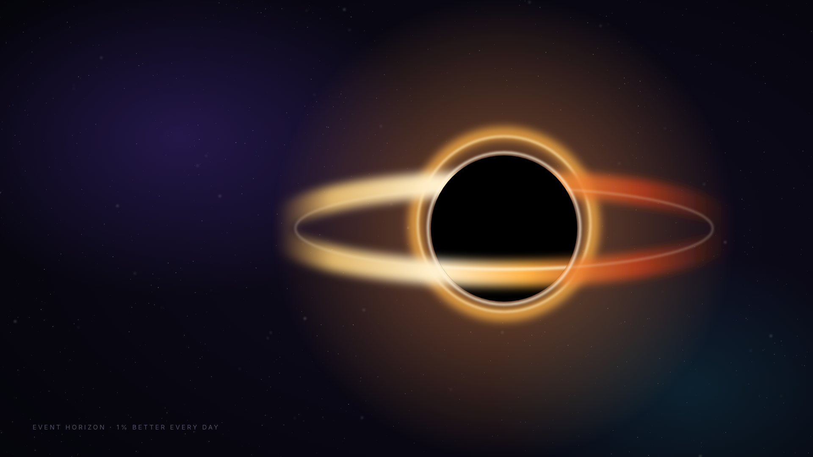

# Event Horizon — workstation theme

A deep-space / black-hole theme for your desktop and Claude Code.



## What's inside

| Path | What it is |
|---|---|
| `wallpaper/event-horizon-{4k,1440p,1080p,ultrawide}.png` | Original black-hole wallpaper. The black hole sits right of centre so desktop icons on the left stay readable. |
| `wallpaper/generate.py` + `render.js` | Regenerate it at any size (`node wallpaper/render.js`). |
| `os/EventHorizon.theme` | Windows 10/11 theme: wallpaper, dark mode, orange accent `#FF9A3C`. |
| `claude-code/statusline.sh` | Claude Code status line: model · folder · git branch · context gauge · session cost. |
| `palette.json` | The colour tokens, so you can reuse them in VS Code, terminal, Notion and other apps. |
| `install.ps1` / `install.sh` | One-step installers. |

Status line preview:

```
◉ Opus │ planb │ ⎇ main* │ ███████░░░ 73% │ $0.42
```
The context gauge goes gold, then orange at 70%, then red at 90%, as you get close to the "horizon" (a full context window).

## Install

**Windows 10/11** (PowerShell, inside this folder):
```powershell
powershell -ExecutionPolicy Bypass -File .\install.ps1
```
The status line needs Git Bash and jq: `winget install Git.Git jqlang.jq`

**macOS / Linux (GNOME):**
```bash
bash install.sh      # needs jq: brew install jq  /  sudo apt install jq
```

Both installers back up `~/.claude/settings.json` to `settings.json.bak` before they add the `statusLine` entry. Restart Claude Code afterwards.

**Manual setup:** set the PNG as your wallpaper, turn on dark mode, pick accent `#FF9A3C`, and add this to `~/.claude/settings.json`:
```json
"statusLine": { "type": "command", "command": "~/.claude/statusline-event-horizon.sh", "padding": 0 }
```

## Palette

| Token | Hex | Use |
|---|---|---|
| void | `#030308` | deepest background |
| space | `#0A0814` | panels |
| accretion | `#FF9A3C` | primary accent |
| photon-ring | `#FFD27A` | highlights |
| nebula-violet | `#9B7BFF` | secondary accent |
| blueshift | `#22D3EE` | info / links |
| starlight | `#8B85A8` | muted text |
